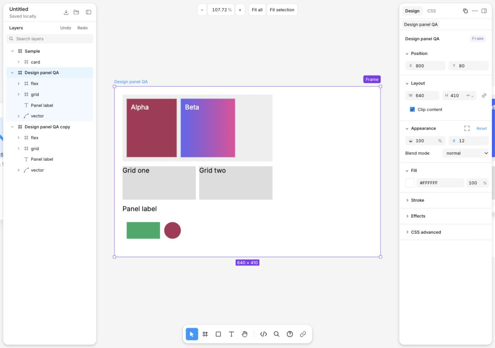

# Design panel implementation

Implementation scope: the existing Frame, HTML, SVG, text and multiple-selection inspectors. Components and variants remain a separate round. The broader Figma research is not declared complete by this implementation.

## Research to implementation

| Research | Implementation |
| --- | --- |
| [Panel shell](../figma/topics/panel-shell.md), [field lifecycle](../figma/topics/input-lifecycle.md) | 240px inspector; 40px section headers; 24px fields/actions; 11px text; 5px field-wrapper radius. Position, Layout, Appearance, contextual Typography, Fill, Stroke, Effects, then CSS advanced. |
| [Parent/child layout](../figma/topics/parent-child-layout.md), [size limits](../figma/topics/size-limits.md) | Contextual Stylesheet/Fixed/Hug/Fill menu. Fill needs an in-flow flex/grid item and a definite parent axis. Existing min/max bounds survive sizing edits and reset. |
| [Mixed types](../figma/topics/mixed-types.md), [mixed paint](../figma/topics/mixed-paint.md) | Shared authored/computed/Mixed/availability/reset state. Unsupported targets do not contribute invented values; subset edits display their scope. |
| [Type UI](../figma/topics/type-ui.md), [text case](../figma/topics/text-case.md), [typography](../figma/topics/typography.md) | Floating Type settings with Basics/Details tabs; decoration dependencies, case, wrapping and font variations. Numeric line height writes pixels; percentage tracking writes em. |
| [Paint/effects](../figma/topics/paint-effects.md), [inner shadow](../figma/topics/inner-shadow.md), [blur](../figma/topics/blur-effects.md) | Floating gradients, shadow editors, layer/background blur; existing CSS expressions remain editable. |
| [Stroke/corners](../figma/topics/stroke-corners.md) | Uniform/individual HTML corners and borders; Frame appearance and border controls; SVG paint/stroke use SVG CSS properties. |

## Architecture and editing

- `propertyState.ts` separates authored declarations, resolved values, variable bindings, Mixed, target support and reset capability. Different bindings can be Mixed even when their resolved colors match; one binding can also resolve differently in separate scopes.
- Numeric, text and RGB fields retain dirty drafts during canvas updates. Untouched blur does not write a stale value. Existing numeric Escape behavior is retained because the Figma observation does not establish a universal rule.
- Shared edits mutate eligible DOM targets before one batched frame commit. Color preview cancellation restores each original target; switching an edit session finishes the preceding session. The existing history model and document schema remain intact.
- Floating editors and suggestion lists are portaled, clamped to the viewport and repositioned on resize/scroll. Sizing menus and Type tabs support arrow navigation; nested color editors do not dismiss their parent effect editor.
- Frame appearance, borders and effects are persisted in an owned `:host` rule in the existing `css` string, between `dom-canvas:frame-style` comments. Other stylesheet content and version-1 documents are preserved. Manual CSS editing remains available.

## Explicit Figma/CSS adaptations

- Root Frames have a document-defined width and Fixed/Hug height. They have no DOM layout parent, so Fill is unavailable. HTML Hug uses intrinsic CSS sizing; Fill uses flex growth or cross-axis/grid stretch. Stylesheet is an additional mode for imported CSS.
- HTML in-flow X/Y uses CSS translation and stays editable; it does not reproduce Figma's disabled Auto layout position controls. Grid and flex item controls remain CSS-specific options under advanced settings.
- HTML/Frame Stroke is a CSS border, with normal box-model/reflow behavior. SVG Stroke retains SVG semantics. Figma inside/center/outside stroke placement and corner smoothing are not fabricated.
- Layer/background blur maps to `filter`/`backdrop-filter`; shadow geometry is CSS box-shadow. Figma progressive blur, Glass, Noise and Shader are outside these CSS controls.
- CSS variables are preserved as authored sources. Macro background/shadow expressions that cannot be represented safely use raw CSS controls. CSS variables/fonts do not imply Figma library, mode or component semantics.
- Multiple selection exposes the common editable properties and marks subset support; it is not the union of every single-object editor.

## Verification

`npm run build` passed. `node --experimental-strip-types --test tests/*.test.mjs` passed **48/48** tests, including property-state, sizing-policy, text metrics, document compatibility and existing history grouping cases. Browser evidence below verifies the changed shared transaction paths with actual DOM rendering.

| Case | Evidence |
| --- | --- |
| HTML multiple selection, Mixed, one-step Undo | [state](evidence/01-mixed-before.txt), [history](evidence/02-mixed-history.json) |
| Cancel shared paint preview restores each target | [cancel](evidence/03-preview-cancel.json) |
| Text, decoration dependencies and CSS rendering | [Type settings](evidence/04-type.json), [metrics](evidence/12-text-metrics.json) |
| Shadow geometry and nested color cancellation | [shadow](evidence/05-shadow.json) |
| SVG geometry edit and Undo | [SVG](evidence/06-svg.json) |
| Frame style persistence, shared width/opacity and mixed clipping | [style](evidence/07-frame-style.json), [batch](evidence/08-frame-batch.json), [clip](evidence/09-clipping.json) |
| Heterogeneous Frame + HTML paint and Undo | [mixed contexts](evidence/10-heterogeneous.json) |
| Save, change width, reopen version-1 file | [round trip](evidence/11-roundtrip.json) |
| 640×500 viewport, popup edges and keyboard tabs | [narrow popup](evidence/13-narrow-popover.json), [font menu](evidence/14-font-menu.json) |
| Grid reflow, hidden element sizing and canvas drag sync | [layout](evidence/15-layout-hidden.json), [drag](evidence/16-canvas-sync.json) |
| Gradient popup, individual corners Mixed, invalid input | [gradient](evidence/17-gradient.json), [fields](evidence/18-field-states.json) |
| Actual panel/field/header measurements | [measurements](evidence/19-measurements.json) |
| Keyboard sizing navigation and untouched field blur | [field values](evidence/21-keyboard-clean-blur.json) |
| Frame border edit and one-step Undo | [Frame stroke](evidence/22-frame-stroke.json) |
| Fill retains min/max; Undo and Redo restore sizes | [bounds/history](evidence/23-fill-bounds-redo.json) |
| Shared Frame + HTML borders restore both targets in one Undo | [mixed stroke](evidence/24-mixed-stroke.json) |

A focused font-size draft also remained `23` through a viewport-driven stylesheet change from 16px to 20px; Enter applied 23px and Undo returned to the stylesheet. This was observed interactively, without a separate evidence file.

Final desktop view at 1280×900:

