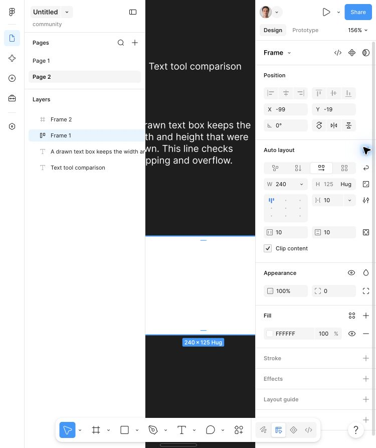
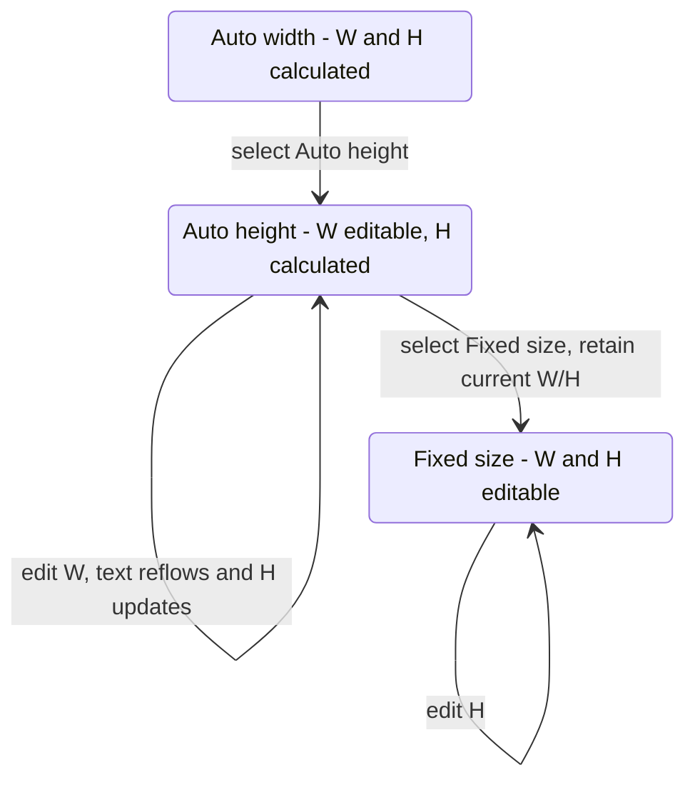

# Design panel — state and dependency map

Priority: **primary research track**, explicitly requested by the user.
Goal: understand the panel as an interacting system before reproducing it in our
product. This is the first behavioral map, not a complete specification.

Tested 2026-10-13 in the browser, Page 2, Design mode, dark theme, canvas zoom 156%.
Actions used actual panel controls; observations used DOM snapshots and computed
styles. No private application state or internal model API was used.

## 1. Context determines the panel

| Selection/context | Layout controls | Additional or changed controls | Evidence |
| --- | --- | --- | --- |
| None | No object dimensions | Page color, opacity, Styles, Export | [Earlier observation](inspector.md) |
| One freeform top-level frame | Flow, W/H, aspect lock, Clip content, Resize to fit | Object alignment disabled in this fixture | [DP-01](../evidence/design-panel/01-freeform-frame.txt) |
| Same frame after enabling Auto layout | Resizing W/H with sizing modes, internal alignment, gap, padding, Wrap | Section title becomes Auto layout; Resize to fit no longer exposed | [DP-02](../evidence/design-panel/02-auto-layout-frame.txt) |
| Text, Auto width | Both dimension inputs disabled | Typography present; corner radius disabled; frame Flow/Clip controls absent | [DP-06](../evidence/design-panel/06-text-auto-width.txt) |
| Text, Auto height | Width editable, height calculated/disabled | Same typography section remains | [DP-07](../evidence/design-panel/07-text-auto-height.txt) |
| Text, Fixed size | Both dimensions editable | Both dimensions retained until edited | [DP-09](../evidence/design-panel/09-text-fixed-enables-height.txt) |
| Two freeform frames | Shared dimensions; distinct values displayed as Mixed | Object alignment enabled, Spacing and Wrap in new section appear; type header still Frame | [DP-15](../evidence/design-panel/15-multiple-frames-mixed.txt) |

The panel is not simply a static set of controls with different values. Selection
kind, layout mode and sizing mode affect section identity, input type, editability
and available actions. Nested-parent context remains to be tested.

## 2. Keep the two kinds of alignment distinct

- **Position > Alignment** concerns the selected objects. It was disabled for a
  single top-level frame and enabled for two selected frames.
- **Auto layout > Alignment** is a nine-position radio group within the container.
  It appeared when Auto layout was enabled, even though the top-level frame's
  Position alignment stayed disabled.
- **Typography > Alignment** has separate horizontal and vertical text groups.

These are separate control families. Do not wire them to one generic alignment
operation in our product. This observation establishes availability, not the outcome
of every alignment action.

## 3. DP-02/03/04 — Auto layout and width form one transition

Fixture: empty Frame 1, X -99/Y -19, W 150/H 125, freeform, Clip checked.

1. Click Toggle auto layout.
2. Observe section change to Auto layout, Horizontal flow selected, both axes Hug,
   gap 10, horizontal/vertical padding 10, internal alignment top-left, Wrap unchecked.
3. Enter 240 in Horizontal resizing, press Enter.
4. Width becomes 240 and loses the inline Hug indicator. Vertical sizing remains
   Hug at 125. The numeric edit makes the horizontal axis fixed.
5. Focus the Move toolbar button and invoke Cmd+Z, avoiding input-local undo.
6. Width returns to 150 **and Hug returns** in the same undo operation.
7. Another Cmd+Z restores freeform Layout and W150/H125.

Evidence: [before](../evidence/design-panel/01-freeform-frame.txt),
[enabled](../evidence/design-panel/02-auto-layout-frame.txt),
[numeric edit](../evidence/design-panel/03-numeric-width-fixed.txt),
[undo width](../evidence/design-panel/04-undo-width-restores-hug.txt),
[undo layout](../evidence/design-panel/05-undo-auto-layout.txt).

The initial flow/gap/padding values are observations for this fixture. Retained
preferences or heuristics have not been ruled out; they are not universal defaults.
Empty-frame Hug behavior does not establish how a populated container sizes.

Accessibility caveat: the snapshot exposed multiple sizing options as selected at
once. Do not infer current mode from those option flags. Use the inline Hug marker,
the visible screenshot and the controlled transition together.

## 4. DP-06 through DP-14 — Text sizing and history

Text fixture `Text tool comparison`, initial dimensions 119 x 15.

| Step | Mode | Width | Height | Editable |
| --- | --- | --- | --- | --- |
| Initial | Auto width | 119 | 15 | Neither dimension |
| Select Auto height | Auto height | 119 | 15 | Width |
| Enter Width 60 | Auto height | 60 | 45 | Width; height follows text reflow |
| Select Fixed size | Fixed size | 60 | 45 | Both |
| Enter Height 80 | Fixed size | 60 | 80 | Both |
| Undo 1 | Fixed size | 60 | 45 | Both |
| Undo 2 | Auto height | 60 | 45 | Width |
| Undo 3 | Auto height | 119 | 15 | Width |
| Undo 4 | Auto width | 119 | 15 | Neither dimension |

Evidence: [auto width](../evidence/design-panel/06-text-auto-width.txt),
[auto height](../evidence/design-panel/07-text-auto-height.txt),
[reflow](../evidence/design-panel/08-text-width-reflows-height.txt),
[fixed](../evidence/design-panel/09-text-fixed-enables-height.txt),
[height edit](../evidence/design-panel/10-text-fixed-height-80.txt),
[undo 1](../evidence/design-panel/11-text-undo-height.txt),
[undo 2](../evidence/design-panel/12-text-undo-fixed-mode.txt),
[undo 3](../evidence/design-panel/13-text-undo-width.txt),
[restored](../evidence/design-panel/14-text-baseline-restored.txt).

Only tested transitions appear in this diagram. Direct Fixed → Auto width, aspect
lock interactions, rich text and auto-layout parenting still require experiments.

## 5. DP-15 through DP-18 — Shared values are individual properties

1. Set Frame 2 width to 200; Frame 1 remains 150. Both heights are 125.
2. Shift-click the adjacent Frame 1 layer label to select both.
3. Panel displays Width Mixed, Height 125, X Mixed, Y -19; horizontal spacing 75.
4. Enter Width 120. Panel displays a common Width 120, Height 125 and spacing 105.
5. One global Undo restores Mixed.
6. Select each frame individually: Frame 1 is 150, Frame 2 is 200.
7. Undo the fixture setup edit: Frame 2 returns to 150.

Evidence: [mixed](../evidence/design-panel/15-multiple-frames-mixed.txt),
[shared edit](../evidence/design-panel/16-shared-width-120.txt),
[undo](../evidence/design-panel/17-shared-width-undo-mixed.txt),
[individual verification](../evidence/design-panel/18-shared-width-restoration.json).

This is property editing across targets, not resizing the union bounding box.
Mixed is a display state for unequal values, not a value to write into the document.
Undo must restore each target's original value, not one common backup value.
The spacing update indicates a related geometry-derived field; spacing edits
themselves have not been tested here.

## 6. Control-level dimensions are not section dimensions

Read-only DOM measurements of the restored freeform frame panel:

| Selected DOM node | Height | Font / line height | Weight | Radius |
| --- | --- | --- | --- | --- |
| Width, Height inputs | 24 | 11 / 16 | 450 | 2 |
| Appearance Opacity, Corner radius inputs | 24 | 11 / 16 | 450 | 2 |
| Position/Layout/Appearance H2 text nodes | 16 | 11 / 16 | 550 | 0 |
| Layout guide header H2 | 32 | 11 / 32 | 550 | 0 |

All units are CSS px where dimensional. Input backgrounds are transparent; wrapper
surfaces must be measured separately. The earlier page-color input had 5px radius,
so a universal input-radius rule would be wrong.

Evidence: [DOM measurements](../evidence/design-panel/19-frame-panel-dom-metrics.json),
[restored baseline](../evidence/design-panel/19-frame-baseline-restored.txt).

## 7. Implementation model suggested by these observations

This is a proposal for our HTML editor, not a claim about Figma's internal code:

1. Derive a selection context: type(s), parent layout, sizing modes, common/mixed values.
2. Derive section visibility and field capabilities from that context.
3. Treat a user edit as a transaction containing value **and mode** changes.
4. Recompute dependent displayed values after the document/layout updates.
5. For multiple selections, keep per-target snapshots for cancellation and Undo.

Relevant existing modules are `Inspector.tsx`, `sizing.ts`, `LayoutItemControls.tsx`,
`InspectorControls.tsx`, `MultipleInspector.tsx`, `MultipleFramesInspector.tsx` and
`useSelectionRefresh.ts` under `src/features/inspector/`. This research pass did not
modify their implementation or verify full local parity.

## 8. Critical remaining research

Parent-child observations now have a [dedicated experiment record](parent-child-layout.md):
in-flow versus Ignore auto layout context, Constraints menu, and a verified
Fill-width/Auto-height transaction with Undo/Redo. Coverage remains partial.

- Child of auto layout: Fill availability, disabled position, absolute positioning,
  constraints, min/max, parent/child resizing feedback.
- Freeform child versus frame versus shape, group, component and instance.
- Mixed-type selections; partial property support and mixed resizing modes.
- [Mixed-type follow-up](mixed-types.md) verifies Count/Ratio and frame-only Clip
  content in heterogeneous selections, and Undo traversing selection changes.
  Mixed sizing modes and text+shape combinations remain open.
- Numeric focus/blur/Enter/Escape, scrub, arrow modifiers, expressions, invalid input.
- Fill/stroke/effect rows: add/remove/reorder, visibility, previews, cancellation,
  color alpha versus object opacity, expanded editors and selection colors.
- Section collapse, scrolling, focus, tooltips, variable/style binding and reset.
- Canvas-to-panel synchronization during move/resize/edit, and complete visual
  measurements including wrappers and transient states.
