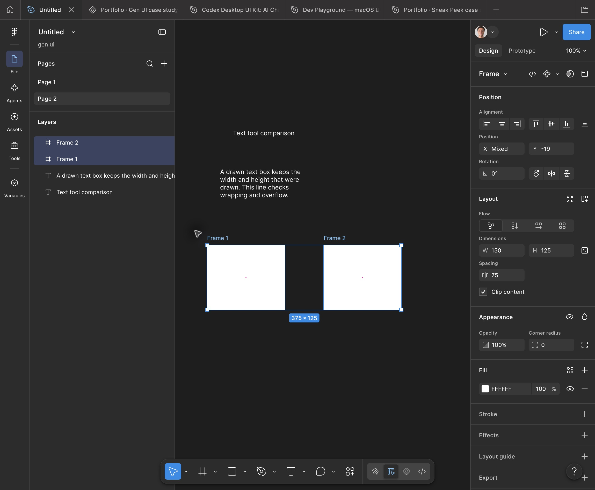

# Canvas and Layers selection

Status: **Observed cases**, not a complete hit-testing specification.
Fixture and coordinate context: [Environment](../ENVIRONMENT.md).

## SEL-01 — Marquee encloses two text objects

Native screenshot coordinates (810,460) → (1240,810), starting in empty canvas.
Both text objects selected; accessibility reported `2 items selected`.
The shared inspector showed Mixed dimensions and Mixed X/Y for these text objects.

## SEL-02 — Marquee partly intersects text

Empty canvas (810,600) → (950,690) intersects only part of the second text box
(850,650) → (1190,740). It selected that text object, with unchanged X/Y and 170 x 45
dimensions. Full enclosure is therefore not required in this tested case.
See [text screenshot](../evidence/2026-10-13-text-fixed.png).

## SEL-03 — Marquee encloses two frames

Create two 150 x 125 frames, horizontally separated. Drag from empty canvas
(760,900) → (1600,1250). Both selected. Shared inspector showed X Mixed, Y -19,
W 150 and H 125. These are common individual dimensions, not their combined bounds.

Evidence: [AX result](../evidence/2026-10-13-frames-enclosed.txt).

## SEL-04 — Marquee partly intersects a frame

Drag (760,900) → (920,1050), crossing the top-left part of Frame 1, whose screenshot
bounds are (800,950) → (1100,1200). Result: Frame 1 selected alone; W 150/H 125.
This extends partial-intersection evidence to a top-level empty frame.

Evidence: [AX result](../evidence/2026-10-13-frame-partial.txt).

## SEL-05 — Shift adds another frame

With Frame 1 selected, Shift-click inside Frame 2 at (1400,1070).
Result: both frames selected. [Evidence](../evidence/2026-10-13-shift-add.txt).

## SEL-06 — Shift removal attempt: inconclusive

With both frames selected, Shift-click inside Frame 1 at (950,1070).
The resulting AX state still reported both selected, including a subsequent full
snapshot. Do not claim toggling/removal from this attempt. Test frame body versus
label versus Layers row separately and verify modifier delivery.

Evidence: [attempt](../evidence/2026-10-13-shift-remove.txt),
[subsequent state](../evidence/2026-10-13-selection-final.txt).

## SEL-07 — Browser Layers label selection

Clicking the gridcell named Frame 1 selected it and exposed X -99/Y -19/W 150/H 125.
Clicking its enclosing row initially produced no selection change. Prefer the
actual label target for browser automation; do not generalize that no-op to users.

Evidence: [browser DOM snapshot](../evidence/2026-10-13-browser-frame-selected.txt),
[browser screenshot](../evidence/2026-10-13-browser-frame-selected.png).

## Open cases

Reverse-direction marquee; drag starting in a frame; nested children; selected
ancestor/descendant; clipping; rotation; hidden/locked objects; Shift-marquee;
Cmd/deep selection; empty-space clearing; range selection; selection restoration.

## Product implication

Current full-containment marquee differs from SEL-02 and SEL-04. An intersection
implementation must still resolve hierarchy/clipping cases through further tests.
