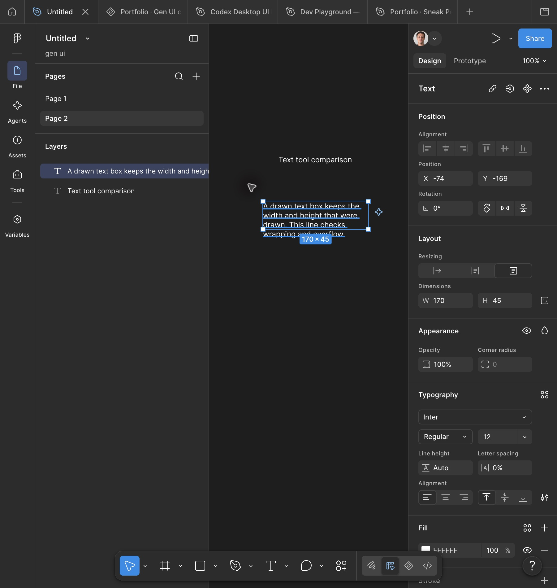

# Text creation and sizing

Status: **Observed**, limited to the Page 2 fixtures in [Environment](../ENVIRONMENT.md).

## TXT-01 — Click creation outside a frame

1. Activate Text with T on an empty page area.
2. Click once and enter `Text tool comparison`.
3. Exit editing with Escape; inspect Layout > Resizing.

Observed: a top-level text layer, Auto width selected, dimensions 119 x 15 after
content insertion. In this state both dimension fields were disabled. Typography
showed Inter Regular, 12px, Auto line height and 0% tracking. These are fixture values,
not proven universal defaults (Figma may retain previous styles).

## TXT-02 — Drag creation outside a frame

1. Activate T, drag a 170 x 45 logical-pixel box.
2. Paste the fixture sentence.
3. Exit editing and inspect dimensions and resize mode.

Observed: **Fixed size**, W 170 and H 45; both fields editable. Pasting wrapping
content retained both dimensions. The text occupies multiple lines.

Do not describe drag creation as Auto height. The three visible modes are Auto width,
Auto height and Fixed size, but conversion behavior has not yet been tested.

## TXT-03 — Enter existing text editing

Double-clicking the first fixture entered a text-editing document. Pasting inserted
the content; Escape returned to object selection. Initial automated typeText did
not insert content, so no general typing failure is attributed to Figma.

## Open cases

- Empty layer click-away/Escape, multiline content and paragraph handling.
- Auto height conversion; text truncation/overflow controls and clipping.
- Text inside frames, auto-layout parents, nested transforms and locked parents.
- Partial character selection, mixed typography, RTL, font changes and unavailable fonts.
- Undo grouping during editing and creation; text tool repeated creation behavior.

## Product implication

Our current drawn text uses automatic height. That differs from TXT-02 and needs a
separate implementation change and local verification. Top-level text creation is
also required; the observed reference does not require a frame first.
